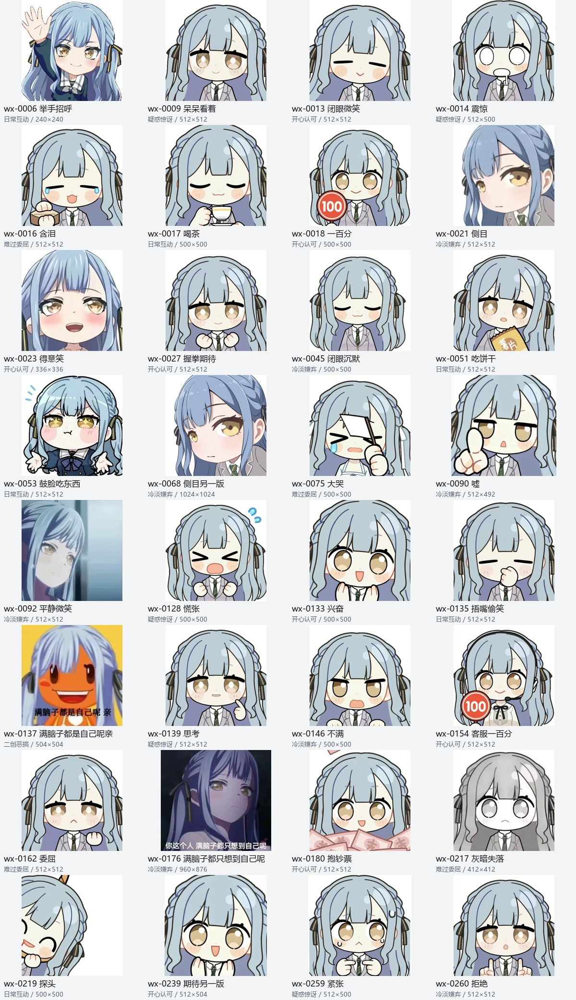

# 丰川祥子 · 情绪表情包

**83 个表情 · 23 个动图 + 60 张静态图 · 10 类情绪与用途**

保留 [MyGO Meme Chat](https://github.com/jason4lin/Mygo-meme-chat) 中的 **51 张**已核验图片，新增从本机微信缓存提取并逐张筛选的 **32 个**祥子表情。

**[一键下载全部图包](https://github.com/linxi9384-glitch/sakiko-emotion-pack/releases/download/v2026.10.25-wechat/sakiko-emotion-pack.zip)** · [下载页](https://github.com/linxi9384-glitch/sakiko-emotion-pack/releases/tag/v2026.10.25-wechat) · [微信新增 32 个预览](previews/wechat-additions.jpg)

## 分类浏览

| 情绪 / 用途 | 数量 | 其中微信新增 | 图片目录 | 拼图预览 |
| --- | ---: | ---: | --- | --- |
| 开心与期待 | 19 | 8 | [打开分类](images/01-%E5%BC%80%E5%BF%83%E4%B8%8E%E6%9C%9F%E5%BE%85/README.md) | [查看拼图](previews/01-%E5%BC%80%E5%BF%83%E4%B8%8E%E6%9C%9F%E5%BE%85.jpg) |
| 温柔与关心 | 1 | 0 | [打开分类](images/02-%E6%B8%A9%E6%9F%94%E4%B8%8E%E5%85%B3%E5%BF%83/README.md) | [查看拼图](previews/02-%E6%B8%A9%E6%9F%94%E4%B8%8E%E5%85%B3%E5%BF%83.jpg) |
| 惊讶与疑惑 | 12 | 5 | [打开分类](images/03-%E6%83%8A%E8%AE%B6%E4%B8%8E%E7%96%91%E6%83%91/README.md) | [查看拼图](previews/03-%E6%83%8A%E8%AE%B6%E4%B8%8E%E7%96%91%E6%83%91.jpg) |
| 生气与质问 | 9 | 1 | [打开分类](images/04-%E7%94%9F%E6%B0%94%E4%B8%8E%E8%B4%A8%E9%97%AE/README.md) | [查看拼图](previews/04-%E7%94%9F%E6%B0%94%E4%B8%8E%E8%B4%A8%E9%97%AE.jpg) |
| 冷淡与嫌弃 | 15 | 7 | [打开分类](images/05-%E5%86%B7%E6%B7%A1%E4%B8%8E%E5%AB%8C%E5%BC%83/README.md) | [查看拼图](previews/05-%E5%86%B7%E6%B7%A1%E4%B8%8E%E5%AB%8C%E5%BC%83.jpg) |
| 难过与委屈 | 8 | 4 | [打开分类](images/06-%E9%9A%BE%E8%BF%87%E4%B8%8E%E5%A7%94%E5%B1%88/README.md) | [查看拼图](previews/06-%E9%9A%BE%E8%BF%87%E4%B8%8E%E5%A7%94%E5%B1%88.jpg) |
| 疲惫与无奈 | 2 | 0 | [打开分类](images/07-%E7%96%B2%E6%83%AB%E4%B8%8E%E6%97%A0%E5%A5%88/README.md) | [查看拼图](previews/07-%E7%96%B2%E6%83%AB%E4%B8%8E%E6%97%A0%E5%A5%88.jpg) |
| 坚定与认真 | 10 | 0 | [打开分类](images/08-%E5%9D%9A%E5%AE%9A%E4%B8%8E%E8%AE%A4%E7%9C%9F/README.md) | [查看拼图](previews/08-%E5%9D%9A%E5%AE%9A%E4%B8%8E%E8%AE%A4%E7%9C%9F.jpg) |
| 日常与互动 | 6 | 6 | [打开分类](images/09-%E6%97%A5%E5%B8%B8%E4%B8%8E%E4%BA%92%E5%8A%A8/README.md) | [查看拼图](previews/09-%E6%97%A5%E5%B8%B8%E4%B8%8E%E4%BA%92%E5%8A%A8.jpg) |
| 二创恶搞 | 1 | 1 | [打开分类](images/10-%E4%BA%8C%E5%88%9B%E6%81%B6%E6%90%9E/README.md) | [查看拼图](previews/10-%E4%BA%8C%E5%88%9B%E6%81%B6%E6%90%9E.jpg) |

## 微信新增预览

以下为新增 32 个表情的静态预览；分类目录中的 GIF 可以直接播放。

## 来源与核验

- MyGO Meme Chat 的 51 张图片保持原文件内容和原有索引位置，索引版本及原始下载地址见清单。
- 微信新增 32 个包含 Q 版、动画截图及单独分类的二创恶搞，按画面命名；名称不是原作者标题。
- 微信文件均从用户本机表情缓存解密，已核验 PNG/GIF 和动图帧，未核实每张表情所属对话。
- 微信私有 WXGF 文件转为 PNG/GIF；解密后的原始图像容器保存在 [originals/wechat](originals/wechat)，便于以后复核。
- 分类同时参考表情、台词和聊天用途，属于主观整理。含少量同框与舞台面具造型，可能涉及剧透。
- 完整尺寸、帧数、来源及 SHA-256 见 [manifest.json](manifest.json)，精简清单见 [index.csv](index.csv)，核验说明见 [VERIFICATION.md](VERIFICATION.md)。
- 图包仅包含筛选后的表情图像与清单，不包含微信账号密钥、聊天数据库或聊天文字。

## 权利说明

本仓库仅作爱好者非营利整理。角色、动画画面和二创素材权利归各自权利人所有；代码开源许可不构成对截图或二创素材的授权。
